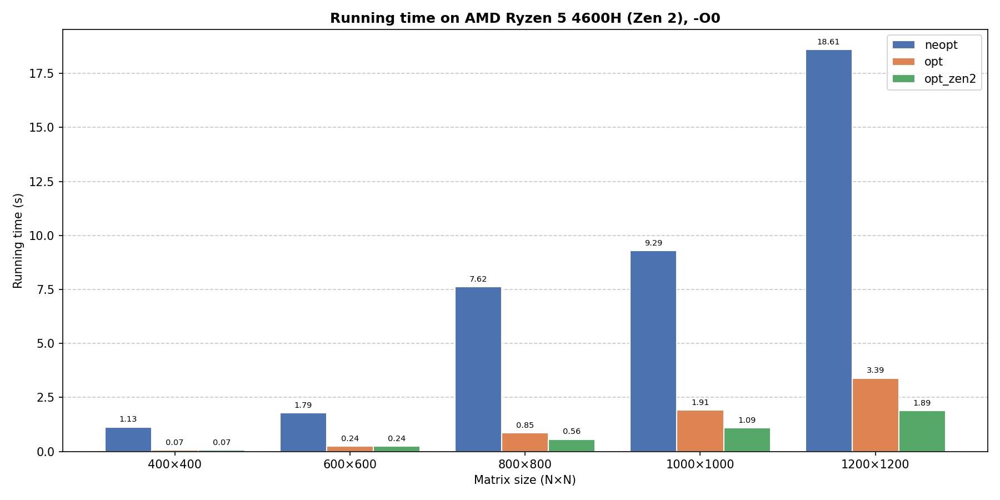

# Architectural Optimizations — Dense Matrix Computation in C

Hand-optimizing a small linear-algebra kernel and measuring how far architecture-aware C can go compared to a naive version and to OpenBLAS.

## The problem

Given `N×N` matrices `A`, `B` and a vector `x`, compute:

```
C = Aᵀ · B
D = C · Cᵀ
y = D · Σᵢ row(C, i) + x
```

Four solvers implement it behind the same `my_solver()` interface:

| Solver | File | Idea |
| --- | --- | --- |
| Naive | `src/solvers/solver_neopt.c` | Direct translation of the formula; only the upper triangle of `D` is computed and mirrored. |
| Optimized | `src/solvers/solver_opt.c` | Loop reordering (`k,i,j`), pointer increments, `register` hints, 4× unrolling with independent accumulators (ILP). |
| Zen 2 tuned | `src/solvers/solver_opt_zen2.c` | Same as above plus cache blocking sized for a 512 KB L2 (`BLOCK_1=40`, `BLOCK_2=20`). |
| BLAS | `src/solvers/solver_blas.c` | `dgemm`, `dsyrk`, `dgemv`, `dsymv`, `daxpy` from OpenBLAS. |

## How it works

- **Loop order.** In `C = Aᵀ·B`, the `i,j,k` order reads `A` with stride `N`. Using `k,i,j` makes `A[k][i]` a loop constant and walks `B` and `C` contiguously.
- **Fewer address computations.** Pointer increments replace `arr[i*N+j]` indexing.
- **Registers and ILP.** Four independent accumulators break the floating-point dependency chain so the FP units stay busy, while staying within 16 YMM registers.
- **Symmetry.** `D` is computed only on one triangle; the `y` term is reduced to a matrix-vector product.
- **Cache blocking (Zen 2).** On a CPU with a smaller L3 (APU), working sets of `C`/`D` are tiled to stay in L2.

## Project layout

```
.
├── Makefile            Builds every solver and the comparison tool into build/
├── include/utils.h     Shared types and prototypes
├── src/
│   ├── main.c          Test driver: generates data, times my_solver(), writes output
│   └── solvers/        Naive, optimized, Zen 2 and BLAS implementations
├── tools/
│   ├── compare.c       Compares two result files within a tolerance
│   ├── benchmark.sh    Times every built solver and writes a CSV
│   └── plot_times.py   Bar chart of running times per matrix size from CSV files
├── input/              Test descriptors (N, seed, output file)
├── results/            Benchmark CSVs and plots
├── references/         Reference outputs (generated in the cluster's Apptainer environment)
└── profiling/          Cachegrind and Valgrind reports (haswell/, zen2/)
```

## Build and run

Requirements: `gcc`, `make`, OpenBLAS headers (`cblas.h`) for the BLAS solver, `matplotlib`/`numpy` for plotting.

```bash
make                                   # builds into build/
./build/solver_opt input/input         # runs 5 tests, writes out1..out5
./build/compare out1 references/out1 1e-6
tools/benchmark.sh input/input results/times.csv   # time all built solvers
python3 tools/plot_times.py results/times.csv -o results/times.png
```

Input format: first line is the number of tests, then one `N seed output_file` per line.

## Tested architectures

| | Intel Xeon E5-2640 v3 (Haswell) | AMD Ryzen 5 4600H (Zen 2, Renoir) |
| --- | --- | --- |
| Environment | Cluster node (Apptainer) | Laptop APU |
| Process | 22 nm | 7 nm |
| Frequency | 2.6 GHz base, 3.5 GHz boost | 3.0 GHz base, 4.0 GHz boost |
| L1d / L2 (per core) | 32 KB / 256 KB | 32 KB / 512 KB |
| L3 | 20 MB, 20-way | 8 MB (2 × 4 MB), 16-way |
| Memory | 64 GB DDR4-2133, ~59.7 GB/s | 16 GB DDR4-3200, ~51.2 GB/s |
| Vector registers | 16 × YMM | 16 × YMM |
| Compiler | GCC 14.3.1 | GCC 15.2.1 (16.2.1 for the plot below) |

Haswell's large L3 keeps the whole working set resident at N=1200, so plain loop optimizations are enough. Zen 2 has a bigger L2 but a much smaller L3, so the Zen 2 solver tiles the work to fit L2.

## Results

Wall-clock time per matrix size on the Ryzen 5 4600H (`-O0 -march=native`), produced with `tools/benchmark.sh` and `tools/plot_times.py`:



| N | naive (s) | optimized (s) | optimized + blocking (s) |
| --- | --- | --- | --- |
| 400 | 1.13 | 0.07 | 0.07 |
| 600 | 1.79 | 0.24 | 0.24 |
| 800 | 7.62 | 0.85 | 0.56 |
| 1000 | 9.29 | 1.91 | 1.09 |
| 1200 | 18.61 | 3.39 | 1.89 |

Blocking only pays off once the matrices stop fitting comfortably in cache (N ≥ 800). To compare architectures, run the benchmark on another machine and plot both files together:

```bash
tools/benchmark.sh input/input results/haswell.csv
python3 tools/plot_times.py results/haswell.csv results/zen2.csv -o results/compare.png
```

## Profiling

```bash
valgrind --leak-check=full ./build/solver_opt input/input_valgrind
valgrind --tool=cachegrind ./build/solver_opt input/input_valgrind
```

Stored reports live in `profiling/`, measured on an Intel Xeon E5-2640 v3 (Haswell) and an AMD Ryzen 5 4600H (Zen 2).
